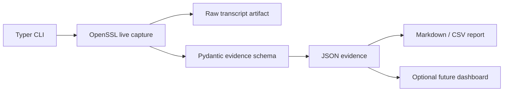

# Quantum-Inspired-Migration-Actual-Cost

**Evidence-first TLS 1.3 PQC migration measurement lab.** The repository name is retained; this branch adds a Python package and CLI prototype.

> No synthetic metrics. A requested group is not a negotiated group. A null metric is not zero.

## Current capability and honest boundaries

The live adapter invokes local OpenSSL s_client against a real endpoint, preserves its raw transcript, extracts peer certificate DER sizes from emitted PEM certificates, and records local process wall-clock duration. It records a negotiated group only when a recognizable OpenSSL diagnostic line is present.

The adapter deliberately leaves key-share lengths, CertificateVerify signature length, serialized handshake bytes, TLS record bytes, TCP/IP bytes, and resumption status **not measured**. OpenSSL diagnostic text is not a packet capture, and process duration is not isolated handshake latency. Offline PCAP parsing, TLS key-log decryption, exact wire-byte accounting, and automated resumption are not yet implemented.

## Install

```bash
python -m venv .venv
source .venv/bin/activate
python -m pip install -e ".[dev]"
pqtls --help
```

OpenSSL must be installed separately. Hybrid groups are available only when the local OpenSSL build and remote server support them. Check `openssl version` and `openssl list -tls-groups` where supported.

## Capture a real connection

```bash
pqtls measure --host www.example.com --port 443 --group X25519 --out results/classical.json
pqtls report results/classical.json --format markdown --out results/classical.md
pqtls report results/classical.json --format csv --out results/classical.csv
```

Request a hybrid group only against a known PQC-enabled endpoint:

```bash
pqtls measure --host your-pqc-enabled-server.example --group X25519MLKEM768
```

The requested group is not proof of negotiation. Inspect `negotiated_group`, `negotiation_verified`, and the preserved transcript. An unrecognized diagnostic format results in an unverified group, not an assumption.

## Evidence model

Every metric includes one of `Measured`, `Specification-derived`, `Calculated`, or `Example`; a named baseline, path, method, limits, and provenance. A missing value is null with `not_measured_reason`.

```bash
pqtls compare results/classical.json results/hybrid.json --metric client_process_duration
```

Comparison arithmetic is labeled `Calculated`, not a new measurement.

## Architecture



## Optional dashboard

Install the optional dependency and run the viewer. It accepts only validated evidence JSON generated by this project; it does not generate demo rows.

```bash
pip install -e ".[dashboard]"
streamlit run dashboard/app.py
```

A starter operator configuration is in `config.example.yaml`; the current CLI uses explicit command-line flags and does not yet load YAML automatically.

## Development

```bash
pip install -e ".[dev]"
pytest
ruff check .
black --check .
mypy src/pqtls
```

## Limitations

- Certificate DER bytes are the sum of peer certificates printed by OpenSSL. They are not TLS Certificate message bytes; framing, per-certificate extensions, compression, and record framing are excluded.
- Process duration includes process startup, DNS, TCP/TLS activity, and shutdown. It is not isolated handshake latency or CPU time.
- TLS 1.3 encrypts most handshake messages after ServerHello. A passive capture needs session secrets to decode Certificate and CertificateVerify.
- TCP/IP accounting requires packet capture at a documented interface and careful treatment of retransmissions, offload, segmentation, link-layer framing, and capture drops.
- Resumption must be proven from the handshake, not inferred from a second connection.

## Roadmap (not implemented claims)

1. Add tshark-backed PCAP parsing with optional TLS key-log decryption.
2. Parse ClientHello/ServerHello key_share vectors from decoded structures and verify selected group.
3. Extract CertificateVerify signature vector length from decrypted handshake bytes.
4. Add repeatable full/resumed session harness with ticket reuse and protocol-level verification.
5. Add a dashboard that filters to measured evidence only.

## References

- [RFC 8446 — TLS 1.3](https://www.rfc-editor.org/rfc/rfc8446.html)
- [RFC 10024 — PQ/T hybrid TLS 1.3 key agreement](https://www.rfc-editor.org/rfc/rfc10024.html)
- [NIST FIPS 203 — ML-KEM](https://csrc.nist.gov/pubs/fips/203/final)
- [NIST FIPS 204 — ML-DSA](https://csrc.nist.gov/pubs/fips/204/final)

See [docs/measurement-boundaries.md](docs/measurement-boundaries.md) for detailed boundaries.
